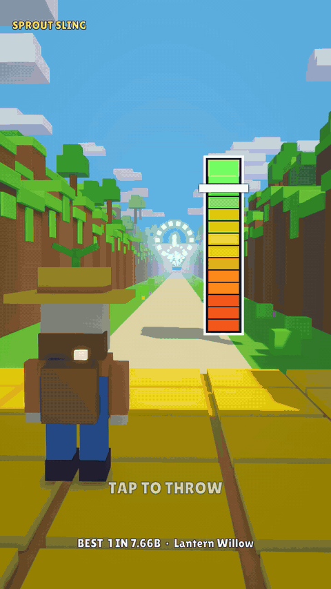
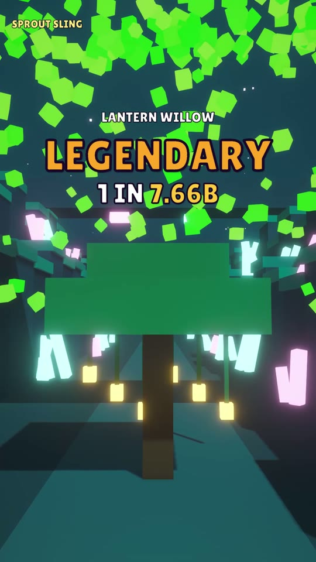
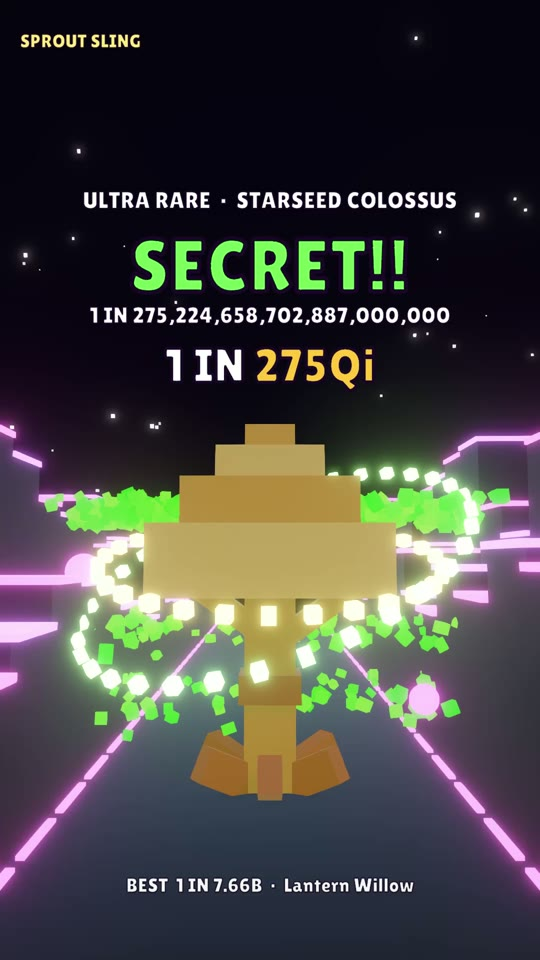

# Sprout Sling

Stop the power meter, sling a seed down a long voxel canyon, pile up luck, and roll for a rare plant.

  
  

## How to play

- A vertical power meter (red at the bottom, green at the top) sweeps up and down. Stop it with **Space**, a **mouse click**, a **tap** or the **gamepad south button**.
- The seed flies down the canyon with a chase camera. A stop at 0.9 or above is **PERFECT** and sends it all the way; weaker stops land earlier.
- Goal: get the highest luck and the rarest plant. The LUCK counter grows ten times every 70 m, and every green clover ring the seed passes multiplies it by 3. The canyon changes from Sunny Meadow to Glow Grotto to Starless Rift.
- On landing, silhouettes with "1 IN ..." odds roll through the tiers, then a flash reveals the real plant: Pebble Sprout, Puff Bush, Crystal Fern, Lantern Willow, Halo Oak, and the SECRET Starseed Colossus. The best find is kept and the next round starts.

## How to open it

1. Open the folder in **Unity 6000.5.4f1** (URP, Input System). Unity restores the packages from `Packages/manifest.json`.
2. Open the scene `Assets/SproutSling/SproutSling.unity`.
3. Press **Play**.

Everything is built at runtime from Unity primitives, so there are no model or texture imports. The Satura Space editor hooks are inside `#if UNITY_EDITOR && SATURA_SPACE`, so the project opens and plays in plain Unity.

## Created by Satura Space

This game was made with [Satura Space](https://github.com/saturadev/satura-space) ([saturaspace.com](https://saturaspace.com)), a free, open source tool that turns a clip into a playable game. A TikTok link ([inspired by @mark.sanx4](https://www.tiktok.com/@mark.sanx4/video/7708834482748509461)) was pasted into Satura Space. A Claude agent watched the clip's frames, searched GitHub for how others solved the core mechanic (a timing power meter and a chase camera), built the game in Unity, playtested it with a bot and filmed it.

## Model and cost

Claude Opus 5.5 (xhigh effort) in Claude Code. At Anthropic API list prices this run would have cost about **$7.11**. That is an estimate: 250 input tokens, 112,360 output tokens, 14,095,261 cache-read tokens and 255,080 cache-write tokens (1 hour), summed across every session for the game.

## Credits

- Idea: [@mark.sanx4](https://www.tiktok.com/@mark.sanx4/video/7708834482748509461) on TikTok.
- Code, models and art are original, built from Unity primitives, and released under the MIT licence.
- No third-party code. For ideas only, the agent read `matheem/timingMeterBase` (ping-pong pointer with zones) and `healeycodes/unity-smooth-camera-follow` (SmoothDamp follow camera). Neither has a licence, so none of their code is used.
- Font: [Lilita One](https://github.com/google/fonts/tree/main/ofl/lilitaone) by Juan Montoreano, SIL Open Font License 1.1.
- TextMesh Pro Essential Resources (Unity package content) include Liberation Sans, SIL Open Font License 1.1 (`Assets/TextMesh Pro/Fonts`).
